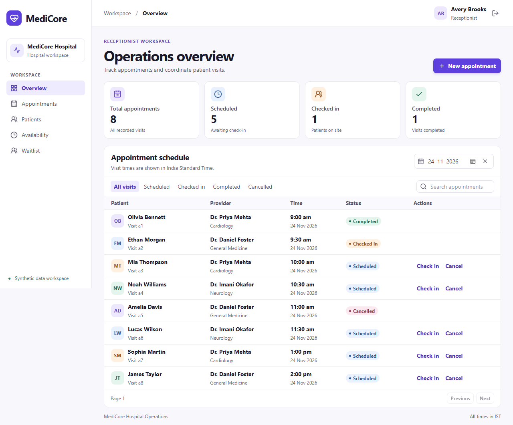
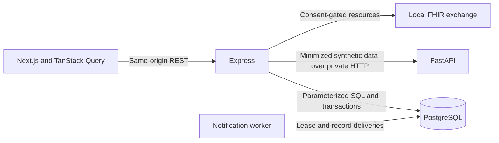
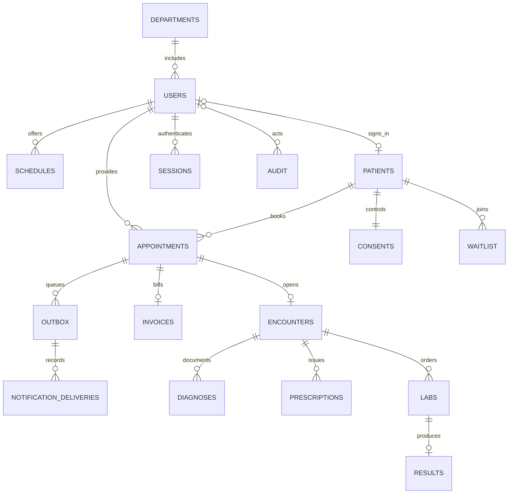

<div align="center">

# MediCore

**Hospital operations and patient-care management**

Next.js · TypeScript · Express · PostgreSQL · FastAPI

[Quick start](#run-the-local-demo) · [Demo walkthrough](#walk-through-the-capstone) · [Architecture](#how-it-works) · [Verification](docs/evidence/RESULTS.md)

</div>

## Overview

MediCore is an educational hospital operations platform built with synthetic records. It connects appointment booking, clinical care, laboratory work, billing, consent, and auditing in role-specific workspaces.

| Workflow | What MediCore supports |
| --- | --- |
| Scheduling | Provider availability, conflict prevention, waitlists, check-in, and cancellation |
| Patient care | Encounters, diagnoses, prescription states, lab orders, and results |
| Hospital operations | Patient registration, staff provisioning, departments, invoices, and analytics |
| Access and exchange | Scoped sessions, consent, audit history, and local FHIR-format exports |



## Run the local demo

Use Node.js 20.20+ or Node.js 22. Run the following in this directory.

```powershell
npm ci
npm run dev
```

Open [MediCore](http://127.0.0.1:3080). Enter a seeded account email and password to sign in. Patient and appointment records appear after the server authenticates the account. The developer launcher seeds demo accounts and saves its embedded PostgreSQL database to `.data/pg`. Set `DATA_DIR` to a separate directory for a fresh demo. Express listens on loopback port 4080. Both ports can be overridden with `WEB_PORT` and `API_PORT`.

**Demo password** `MediCoreDemo!`

| Role | Demo email |
| --- | --- |
| Receptionist | `reception@medicore.test` |
| Doctor | `doctor@medicore.test` |
| Nurse | `nurse@medicore.test` |
| Lab technician | `lab@medicore.test` |
| Billing officer | `billing@medicore.test` |
| Administrator | `admin@medicore.test` |
| Patient | `patient@medicore.test` |

### Analytics

Use Python 3.12 and a virtual environment. Start Python before the Node launcher and provide both services with the same local analytics key.

```powershell
python -m venv .venv
.venv/Scripts/python -m pip install -r analytics/requirements.txt
$env:ANALYTICS_KEY = 'medicore-local-only'
.venv/Scripts/python -m uvicorn main:app --app-dir analytics --host 127.0.0.1 --port 8000
```

In the Node terminal set `ANALYTICS_KEY` to the same value and `ANALYTICS_URL` to `http://127.0.0.1:8000`. An administrator can open **Reports** for attendance, schedule utilization, check-in wait, lab turnaround, and age-band counts. Wait is measured against the appointment time and is zero for early check-ins.

## Docker and verification

Copy `.env.example` to `.env`, fill the PostgreSQL password and analytics key, and run `docker compose up --build`. The database uses a private Compose network and named volume. The API applies its versioned schema in a migration transaction at startup. Open the same localhost URL.

```text
npm run typecheck
npm test
npx playwright install chromium
npm run test:e2e
python -m pytest -q analytics
```

## Walk through the capstone

1. Sign in as **Receptionist**. Open **New appointment** and choose Olivia Bennett and Dr. Priya Mehta on the seed date at 09:00–09:30 IST. The API returns a conflict because the provider already has an appointment there. Choose 15:00–15:30 IST for a free slot on the fresh demo.
2. Sign in as **Patient**. Olivia sees her own visits and released care records. Open **Patients → Manage consent** and turn off care-team and FHIR access.
3. Sign in as **Doctor**. Dr. Priya's visit schedule stays visible, while Olivia's clinical details are restricted. Re-enable consent to restore care access. The Patient FHIR ID is `p1`, the sample Observation ID is `l1`.
4. Sign in as **Administrator** and open **Audit log** to see clinical reads, actions, and denied requests. **Notifications** shows the local sandbox worker's delivery state for booking and cancellation events.
5. Sign in as **Lab technician**. Collect the Glucose order, then enter a synthetic result using mg/dL and a reference interval. The API requires collection and validates units and result metadata.

If the demo was seeded on a previous date, clear the schedule date filter and use that seed date for the overlap walkthrough. New availability can be added from **Availability** as an administrator or doctor.

## How it works



The Express API owns hospital records. The browser keeps an opaque HTTP-only session cookie, and the database stores its hash. Refresh rotates it and logout revokes it. API routes check role permissions and then limit records to the patient, assigned doctor, or nursing department. Consent gates clinician access and FHIR exchange. Administrative roles receive operational summaries, with clinical notes reserved for care roles and the patient. Database changes and their success audit entries commit together.

Booking locks the provider and patient rows inside one transaction before checking availability and half-open time ranges. A competing booking for either party waits for the lock and sees the committed record before checking for overlap. PostgreSQL timestamps carry offsets, while the demo displays Asia/Kolkata.



See [API specification](docs/openapi.json), [Postman collection](docs/MediCore.postman_collection.json), and [assessment status](docs/ASSESSMENTS.md).

## Submission status

The local build was verified with 9 API tests on both embedded and native PostgreSQL, 3 Playwright tests, and 4 FastAPI tests. See [local verification](docs/evidence/RESULTS.md) for results.

The Compose configuration and CI workflow are included. Full container execution, hosted CI evidence, cloud deployment, and external notification delivery remain open. The demo uses a database-backed email and SMS sandbox. See the [assessment checklist](docs/ASSESSMENTS.md) for module-level status.
